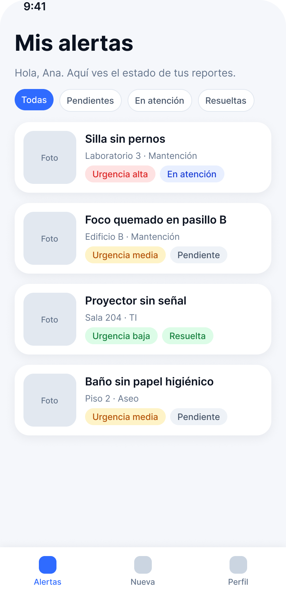
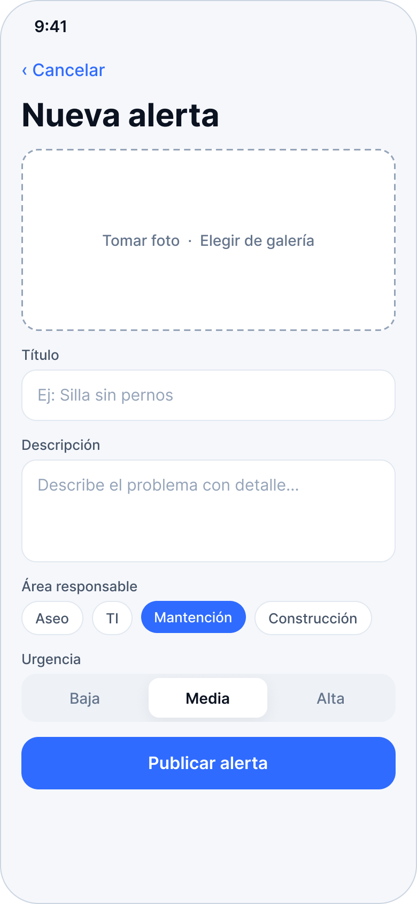
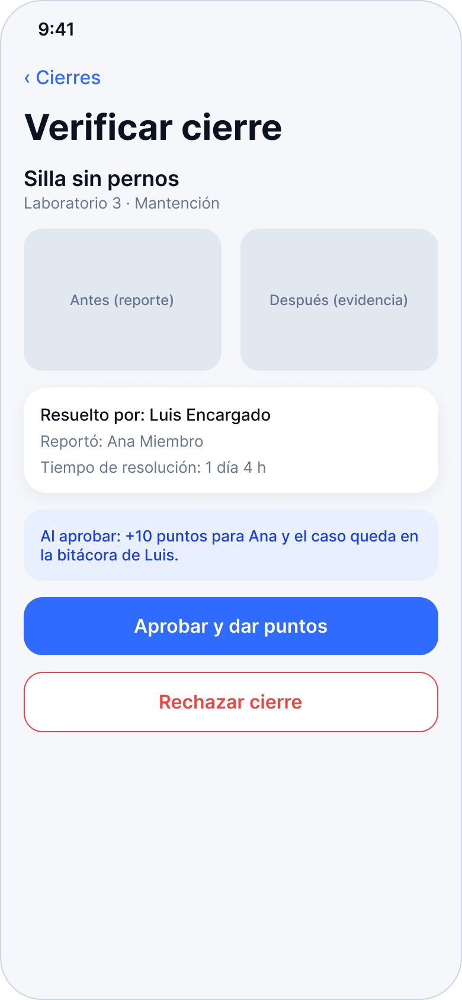

# Fixly 🔧

> Reporta, asigna y resuelve. App móvil para detectar y gestionar averías en instituciones con mucha gente.


## ¿Qué es Fixly?

En instituciones con alta densidad de personas (universidades, colegios, empresas), detectar a tiempo una avería depende de que alguien avise al encargado o de que este la vea por casualidad. **Fixly** conecta a quienes detectan un problema con quienes tienen que resolverlo, de forma directa, trazable y verificable.

El proyecto parte desde el caso de la Universidad de Los Lagos, con la idea de escalar a otras instituciones.

## ¿Cómo funciona?

1. Un **miembro** (alumno, trabajador) publica una alerta con foto, título, descripción, urgencia y área responsable.
2. La alerta se publica **de inmediato** y el **encargado** del área recibe el aviso.
3. El encargado acepta el caso, lo resuelve y sube evidencia.
4. El **administrador** modera las publicaciones falsas y aprueba el cierre del caso.
5. El miembro que reportó **gana puntos** y el caso queda en la **bitácora** del encargado.

## Roles

| Rol | Qué hace |
|---|---|
| Miembro | Publica alertas, sigue su estado y acumula puntos |
| Encargado | Recibe alertas de su área, acepta y resuelve casos, y mantiene su bitácora |
| Administrador | Declina publicaciones falsas, verifica cierres y aprueba la entrega de puntos |

## Diseño

Wireframes y guía de estilo en [Figma](https://www.figma.com/design/MMwruC6KJkDcTfi41Zc6zV).
Estilo: minimalista tipo iOS, con acentos futuristas en azul y cian.

<p align="center">
  
  
  
  
</p>

## Stack tecnológico

| Capa | Tecnología |
|---|---|
| App móvil | React Native + Expo |
| Backend (API REST) | Node.js + Express + Mongoose |
| Base de datos | MongoDB Atlas |
| Visualización durante el desarrollo | Expo Go |
| Notificaciones | Firebase Cloud Messaging (por integrar) |

## Estado del proyecto

- [ ] Migrar la base móvil actual de Flutter a React Native + Expo
- [ ] Configurar Expo Go para visualizar la app durante el desarrollo
- [ ] Implementar navegación y login con roles (datos de prueba)
- [x] Wireframes y guía de estilo en Figma
- [ ] Aplicar la paleta visual en React Native
- [ ] Pantallas del miembro (lista, crear alerta con cámara, detalle, perfil)
- [ ] Backend con Node + Express + MongoDB
- [ ] Autenticación real (JWT) y roles
- [ ] Flujo del encargado y bitácora
- [ ] Módulo de moderación del administrador
- [ ] Sistema de puntos
- [ ] Notificaciones push

## Estructura del repositorio

```
Fixly/
├── mobile/     # App móvil React Native + Expo (migración pendiente)
├── backend/    # API REST (próximamente)
├── docs/       # Wireframes, guía de diseño y bitácora
└── README.md
```

## Cómo correr la app

La carpeta `mobile/` todavía contiene el proyecto Flutter existente. Cuando se complete la migración a React Native + Expo, se podrá iniciar la vista de desarrollo así:

```bash
git clone <url-del-repositorio>
cd Fixly/mobile
npm install
npx expo start
```

Escanea el código QR con Expo Go para visualizar la app en un dispositivo, o elige un emulador desde la terminal.

Cuentas de prueba temporales (clave `1234`), cuando el login esté implementado: `miembro@fixly.cl`, `encargado@fixly.cl`, `admin@fixly.cl`.

## Contexto

Proyecto desarrollado para el ramo Tecnologías Web y Móviles, Ingeniería Civil en Informática, Universidad de Los Lagos.

## Autor

**Benjamin Concha**