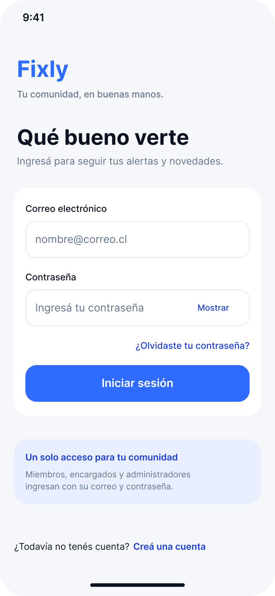
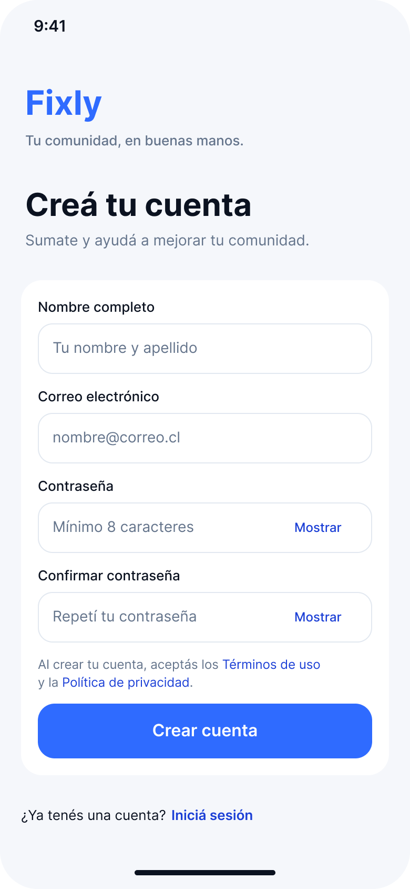
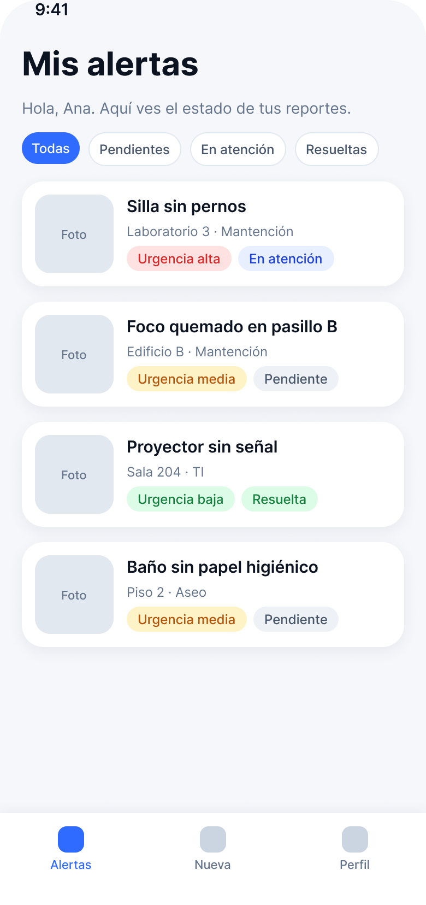
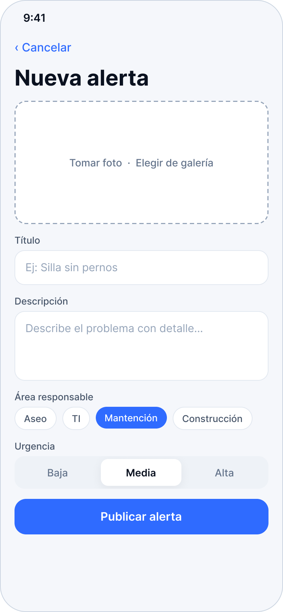
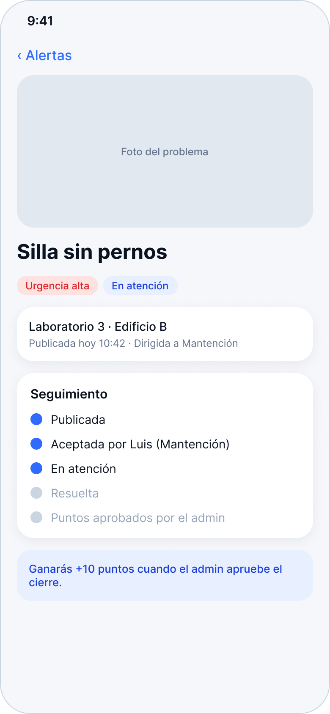
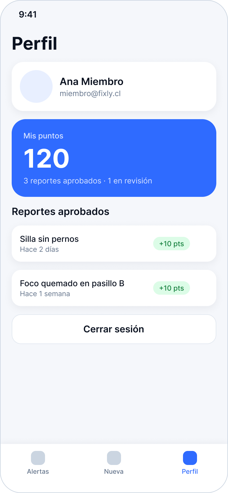
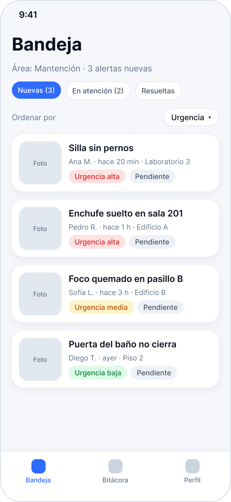
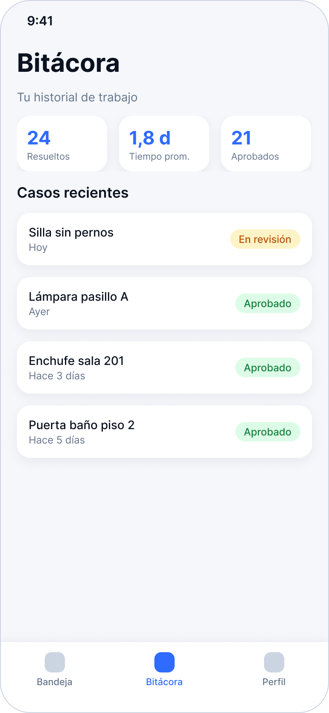
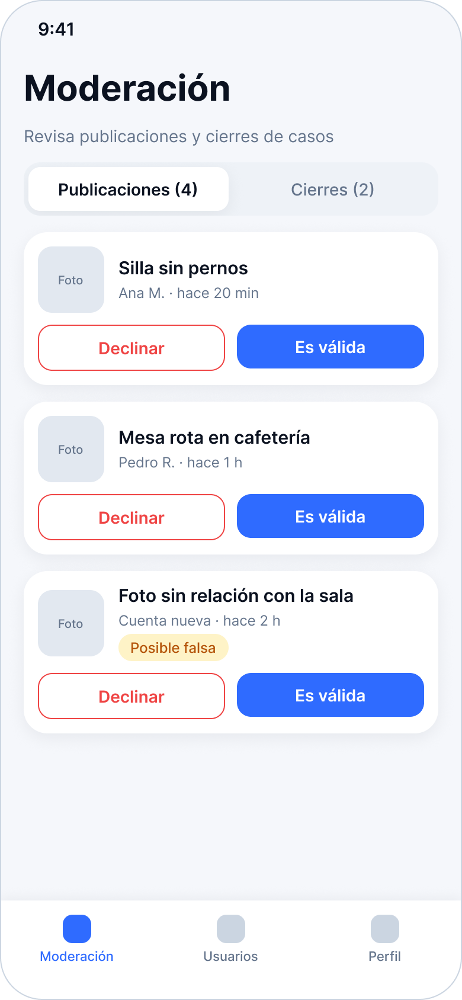
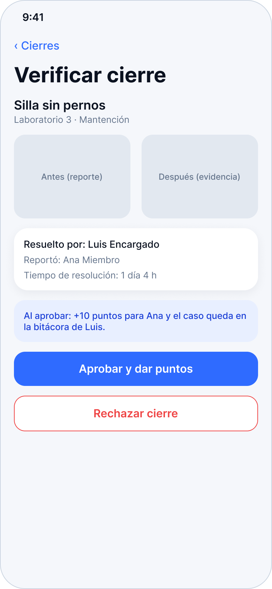

# Fixly 🔧

> Reporta, asigna y resuelve. App móvil para detectar y gestionar averías en instituciones con mucha gente.


## ¿Qué es Fixly?

En instituciones con alta densidad de personas (universidades, colegios, empresas), detectar a tiempo una avería depende de que alguien avise al encargado o de que este la vea por casualidad. **Fixly** conecta a quienes detectan un problema con quienes tienen que resolverlo, de forma directa, trazable y verificable.

El proyecto parte desde el caso de la Universidad de Los Lagos, con la idea de escalar a otras instituciones.

## ¿Cómo funciona?

1. Un **miembro** (alumno, trabajador) publica una alerta con foto, título, descripción, urgencia y área responsable.
2. La alerta se publica **de inmediato** y el **encargado** del área recibe el aviso.
3. El encargado acepta el caso, lo resuelve y sube evidencia.
4. El **administrador** modera las publicaciones falsas y aprueba el cierre del caso.
5. El miembro que reportó **gana puntos** y el caso queda en la **bitácora** del encargado.

## Roles

| Rol | Qué hace |
|---|---|
| Miembro | Publica alertas, sigue su estado y acumula puntos |
| Encargado | Recibe alertas de su área, acepta y resuelve casos, y mantiene su bitácora |
| Administrador | Declina publicaciones falsas, verifica cierres y aprueba la entrega de puntos |

## Diseño

Wireframes y guía de estilo en [Figma](https://www.figma.com/design/MMwruC6KJkDcTfi41Zc6zV).
Estilo: minimalista tipo iOS, con acentos futuristas en azul y cian.

<p align="center">
  
  
  
</p>
<p align="center">
  
  
  
  
</p>
<p align="center">
  
  
  
  
  
</p>

## Stack tecnológico

| Capa | Tecnología |
|---|---|
| App móvil | React Native + Expo |
| Backend (API REST) | Node.js + Express + Mongoose |
| Base de datos | MongoDB local (Docker) / MongoDB Atlas |
| Visualización durante el desarrollo | Expo Go |
| Fotos de alertas | Subida multipart autenticada (JPG, PNG, WebP) |
| Notificaciones | Expo Push Service |

## Estado del proyecto

- [x] Migrar la base móvil de Flutter a React Native + Expo
- [x] Configurar Expo Go para visualizar la app durante el desarrollo
- [x] Implementar navegación, registro y login con roles (datos de prueba)
- [x] Wireframes y guía de estilo en Figma
- [x] Aplicar la paleta visual en React Native
- [x] Pantallas del miembro (lista, crear alerta con cámara, detalle, perfil)
- [x] Flujos del encargado (bandeja, atención y bitácora)
- [x] Moderación de publicaciones y revisión de cierres por administrador
- [x] Sistema de puntos
- [x] API backend con Node + Express + MongoDB
- [x] Autenticación JWT y permisos por rol en la API
- [x] Conectar la autenticación y las alertas móviles a la API
- [x] Subir y mostrar fotos con permisos autenticados
- [x] Implementar registro de dispositivos y avisos push para los flujos principales
- [x] Configurar FCM para Android y generar un development build
- [ ] Instalar el build y verificar la recepción de una notificación en Android

La API implementa cuentas, alertas, moderación, revisión de cierres, puntos, imágenes y envío de notificaciones. La app móvil guarda el JWT de forma segura, registra el token push con la cuenta y abre la alerta correspondiente al tocar una notificación. Android ya tiene FCM configurado y un development build generado; falta instalarlo en un teléfono y confirmar la entrega real. iOS queda pendiente de credenciales APNs y una membresía Apple Developer. Las imágenes se guardan localmente en desarrollo; para desplegar se debe configurar almacenamiento persistente/objetos.

## Estructura del repositorio

```
Fixly/
├── mobile/     # App móvil React Native + Expo
├── backend/    # API REST con Node.js, Express y MongoDB
├── docs/       # Wireframes, guía de diseño y bitácora
└── README.md
```

## Cómo correr la app

La app móvil usa React Native, Expo y Expo Router. Para iniciar el servidor de desarrollo:

```bash
git clone <url-del-repositorio>
cd Fixly/mobile
npm install
npx expo start
```

Antes de iniciar la app, levanta MongoDB y la API siguiendo [backend/README.md](backend/README.md). Copia `mobile/.env.example` a `mobile/.env.local` y reemplaza la IP por la dirección local de tu computador; el `.env.local` no se sube a Git. Luego inicia Expo:

```powershell
Copy-Item .env.example .env.local
npx expo start
```

Escanea el código QR con Expo Go para visualizar la app en un dispositivo. La API y el teléfono deben estar en la misma red Wi-Fi.

### Notificaciones push

Las notificaciones se envían a encargados cuando llega una alerta de su área, al miembro cuando cambia el estado de su alerta y a administración cuando un cierre queda pendiente de revisión. Para habilitar la recepción en un teléfono:

1. Desde `mobile/`, inicia sesión con `npx eas-cli@latest login` y configura el proyecto con `npx eas-cli@latest build:configure --platform android` (o `ios`). EAS vincula el proyecto y genera `eas.json`.
2. Para Android, crea un proyecto Firebase para `com.fixly.mobile`, descarga `google-services.json` en `mobile/` y configura `android.googleServicesFile` con esa ruta en `app.json`. Sube la clave de cuenta de servicio FCM v1 a las credenciales del proyecto Expo; esa clave privada no debe compartirse ni subirse al repositorio. Para iOS, configura las credenciales de APNs desde el flujo de Expo.
3. Genera un development build con `npx eas-cli@latest build --profile development --platform android` (o `ios`). EAS entrega un enlace para instalarlo; no se necesita conectar el teléfono por cable.
4. Instala el build, inicia el servidor con `npx expo start --dev-client`, abre Fixly, inicia sesión y permite notificaciones.

Las notificaciones remotas requieren un development build; Expo Go no las admite en Android. Para iOS se necesita una cuenta Apple Developer para crear las credenciales APNs.

Cuentas de prueba temporales (clave `1234`): `miembro@fixly.cl`, `encargado@fixly.cl`, `admin@fixly.cl`.

### Backend API

Consulta la [guía del backend](backend/README.md) para configurar MongoDB, iniciar la API, cargar las cuentas demo y crear cuentas de encargado o administrador.

## Contexto

Proyecto desarrollado para el ramo Tecnologías Web y Móviles, Ingeniería Civil en Informática, Universidad de Los Lagos.

## Autor

**Benjamin Concha**